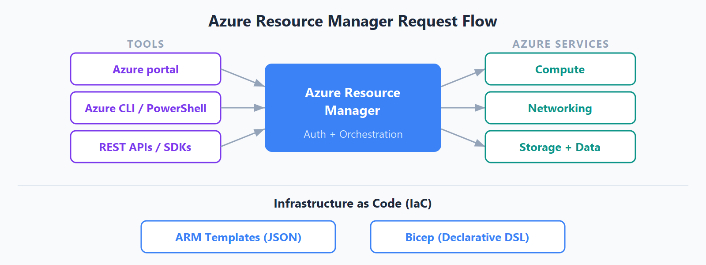

# Tools for Managing and Deploying Azure Resources

## Azure Management Tools

| Tool | Use |
| --- | --- |
| **Azure portal** | Graphical web interface for managing Azure resources. |
| **Azure PowerShell** | PowerShell cmdlets for managing Azure from the command line. |
| **Azure CLI** | Cross-platform command-line interface for Azure. |
| **Copilot in Azure** | Natural-language assistance for understanding and managing Azure. |
| **Cloud Shell** | Browser-based shell with Azure CLI and Azure PowerShell available. |

## Azure Arc

Azure Arc extends Azure management, governance, compliance, and monitoring to
hybrid and multicloud environments, including on-premises infrastructure and
other cloud providers.

### Supported Resources Outside Azure

- Servers
- Kubernetes clusters
- Azure data services
- SQL Server
- Virtual machines (preview)

## Azure Resource Manager (ARM)

Azure Resource Manager is the central deployment and management service for all
Azure resources.

All requests made through the Azure portal, Azure CLI, Azure PowerShell, SDKs,
or REST APIs flow through ARM first. ARM handles authentication and
authorization before the request reaches the relevant Azure service.

## Infrastructure as Code (IaC)

Infrastructure as Code is the practice of managing and provisioning
infrastructure with declarative templates or scripts instead of configuring
resources manually through a user interface.

### ARM Templates

ARM templates are declarative JSON files that describe the desired end state of
Azure resources.

### Bicep

Bicep is a cleaner, domain-specific language for deploying Azure resources. It
provides an alternative to writing JSON ARM templates and compiles to ARM
template JSON.

### ARM Templates vs. Bicep

| Option | Format | Key characteristic |
| --- | --- | --- |
| **ARM templates** | JSON | Native declarative deployment format for Azure. |
| **Bicep** | Bicep language | More concise and readable syntax that compiles to ARM templates. |
